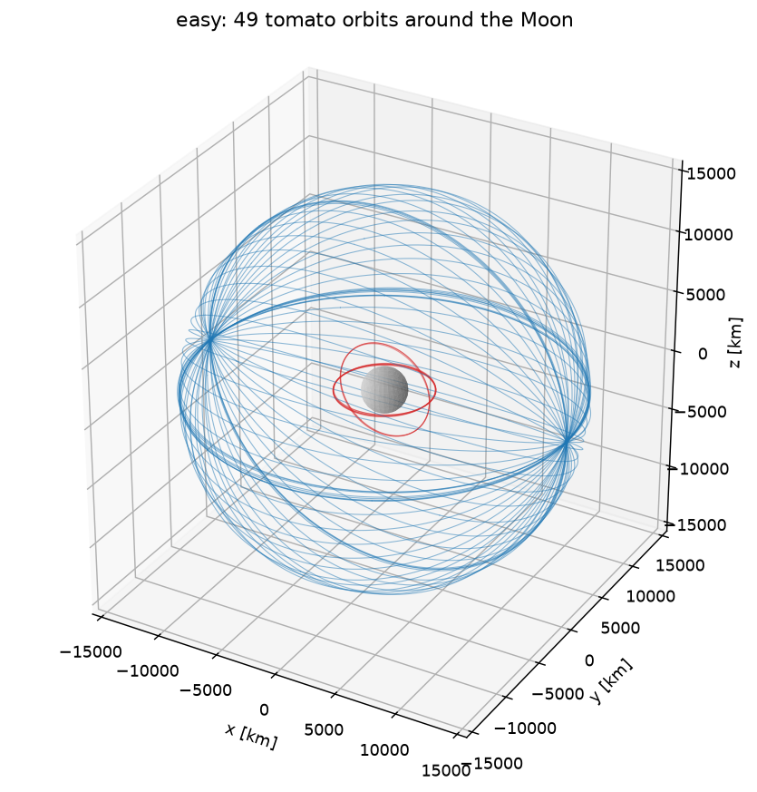
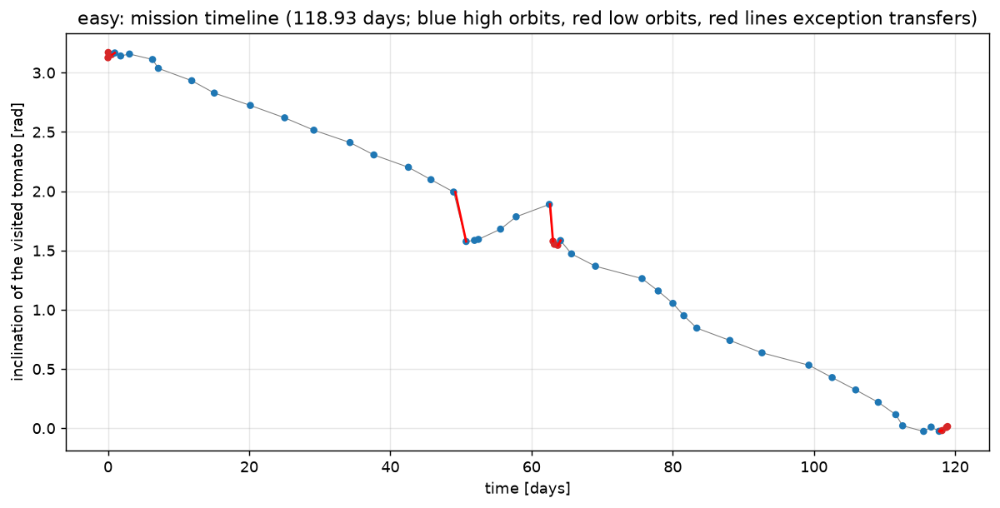
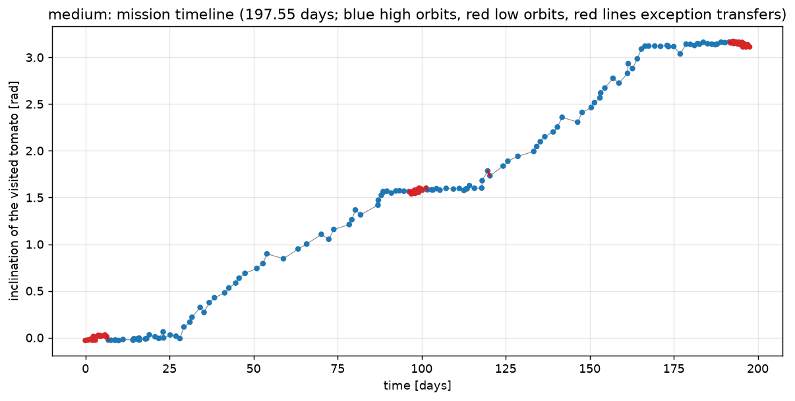
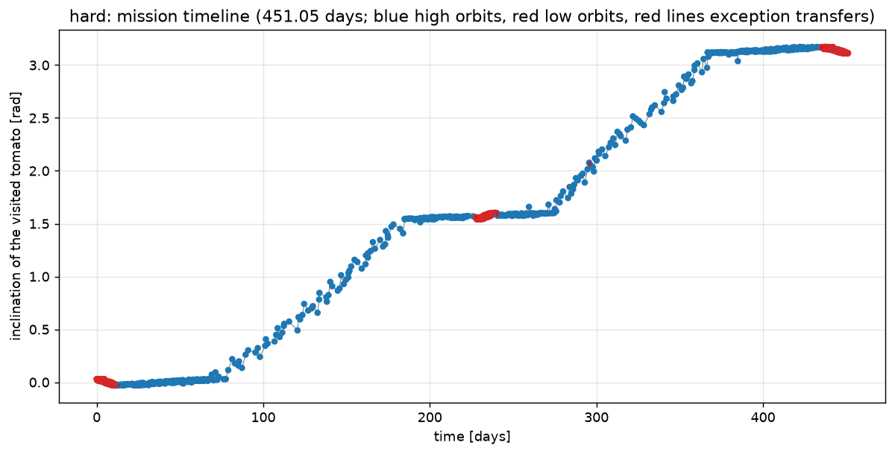
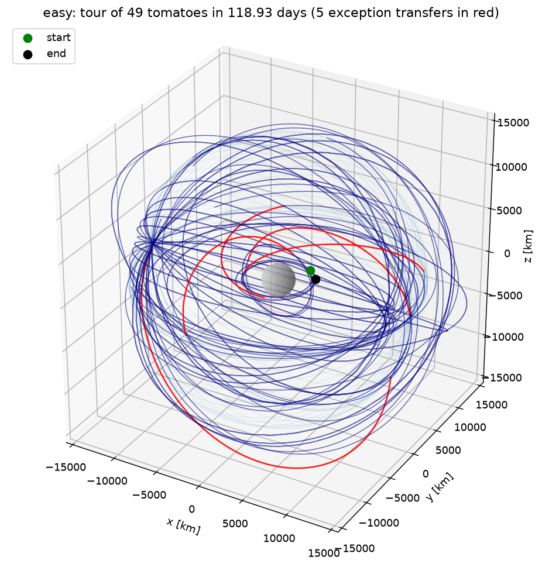
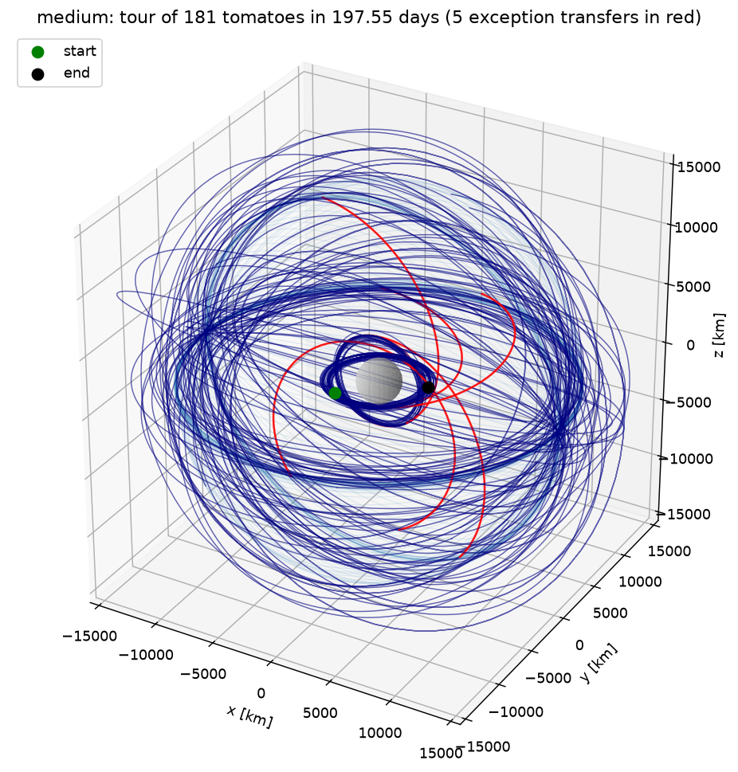
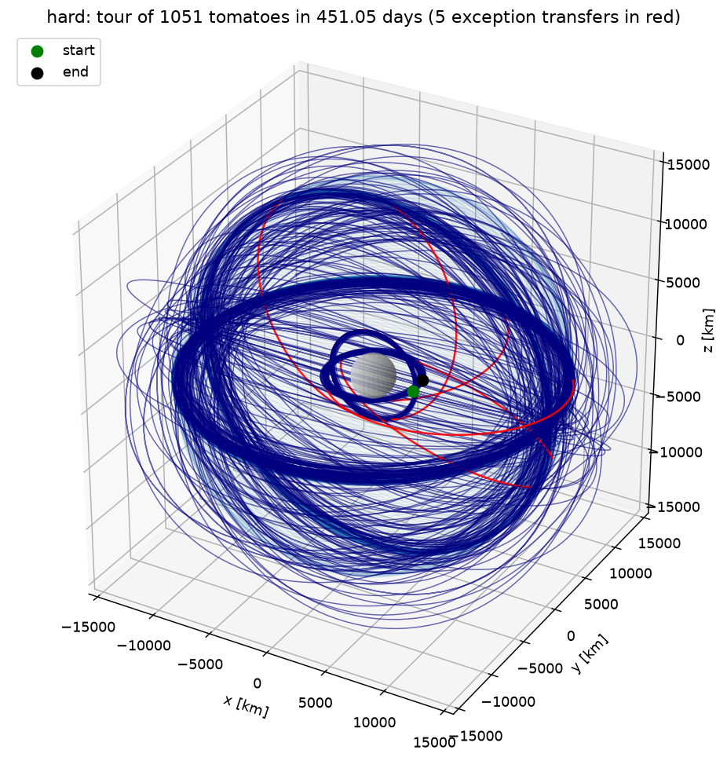

# Keplerian Tomato Traveling Salesperson

A Python solver for Challenge 2 of ESA's fourth Space Optimisation Competition (SpOC 4, GECCO 2026):
[Keplerian Tomato Traveling Salesperson](https://optimise.esa.int/challenge/spoc-4-keplerian-tomato-traveling-salesperson/About).

A cargo spacecraft crashed and spilled its tomatoes into orbits around the Moon. One collector spacecraft has
to visit every tomato as quickly as possible. Each hop between two tomatoes is a two-impulse Lambert transfer
whose cost in delta-v depends on when it starts and how long it takes, and only cheap transfers are allowed.
The problem is therefore a travelling-salesperson problem whose distances are given by orbital mechanics.

Everything in this repository is implemented from scratch with NumPy (orbit propagation, Lambert solver,
evaluator, tour construction and improvement). The numbers were cross-checked against `pykep`, the library behind
the official evaluator, inside a Docker container.

## 1. The problem

Every tomato `k` follows a fixed Keplerian orbit around the Moon (`mu = 4.9048695e12 m^3/s^2`) given by six
elements: semi-major axis `a` [m], eccentricity `e`, inclination `i`, right ascension of the ascending node
`Omega`, argument of periapsis `omega` and mean anomaly `M` at `t = 0` (all angles in radians).

A solution is a decision vector ("chromosome") with `3N - 2` numbers for `N` tomatoes:

```
x = [t_1 ... t_{N-1},  tof_1 ... tof_{N-1},  pi_1 ... pi_N]
```

* `pi_1 ... pi_N` is the visiting order (a permutation of `0 ... N-1`),
* `t_k` is the departure time [days] of the k-th transfer, from tomato `pi_k` to tomato `pi_{k+1}`,
* `tof_k` is its time of flight [days].

The delta-v of a transfer is computed by solving Lambert's problem between the position of `pi_k` at `t_k` and
the position of `pi_{k+1}` at `t_k + tof_k`; the cost is the sum of the two burns, `|v1 - v_dep| + |v_arr - v2|`,
minimised over both directions of motion and over all multi-revolution solutions (up to 20 revolutions).

Constraints:

* `t_k + tof_k <= t_{k+1}`: the spacecraft can wait at a tomato as long as it likes, but cannot leave before it arrives;
* `tof_k >= dt_min`;
* `delta-v_k <= 100 m/s` for every transfer, except for at most `E = 5` "exception" transfers with `delta-v_k <= 600 m/s`;
* the mission must end no later than `t_max`.

Objective: minimise the mission time `f = t_{N-1} + tof_{N-1}`.

### Instances

| instance (name on the platform) | tomatoes | low / high orbits | `dt_min` [d] | `t_max` [d] | limits [m/s] |
|---|---|---|---|---|---|
| easy (Small) | 49 | 9 / 40 | 0.001 | 200 | 100 / 600, E = 5 |
| medium (Medium) | 181 | 60 / 121 | 0.001 | 500 | 100 / 600, E = 5 |
| hard (Large) | 1051 | 450 / 601 | 0.001 | 3000 | 100 / 600, E = 5 |

The files in `data/` are the ones served by the competition platform (`api.optimize.esa.int/data/spoc4/kttsp/problems/`),
with Unix line endings. The copies in the [esa/SpOC4](https://github.com/esa/SpOC4) GitHub repository have the same
orbits but a different `dt_min` for medium (0.01) and hard (1/1440); the parser accepts both. The medium tour is
computed with the stricter 0.01-day minimum (option `--min-tof 0.01`), so all three tours are valid with both versions
of the files.

## 2. What the data looks like

Looking at the orbital elements explains almost everything about how a good tour must look:

* **Two altitudes.** Every tomato is either on a high orbit (`a ~ 14 990 km`, speed 572 m/s, period 1.906 days)
  or on a low orbit (`a ~ 3 747 km`, speed 1 144 m/s, period 0.238 days). All orbits are nearly circular (`e < 0.01`).
* **One common line of nodes.** All `Omega` are between 0 and 0.01 rad, so every orbital plane contains the same
  line. Changing from one plane to another costs a plane change `2 v sin(di / 2)`: with 100 m/s a high tomato can
  reach planes up to 0.175 rad (10 deg) away, a low tomato only 0.087 rad (5 deg).
* **The high orbits form one chain.** Their inclinations are spread evenly between 0 and pi, and the largest gap
  between neighbours (0.104 / 0.052 / 0.021 rad in easy / medium / hard) is below the 0.175 rad limit: the whole
  high group can be swept in inclination order with normal transfers.
* **The low orbits form three clusters** near `i = 0`, `i = pi/2` and `i = pi`. Inside a cluster the gaps are
  small; between clusters they are ~1.5 rad, far more than even an exception transfer can buy at low altitude.
  A cluster can only be entered from, or left for, the high chain with a Hohmann-like transfer (~515 m/s plus a
  small plane change), which is an exception transfer. Starting inside one end cluster is free, leaving it costs
  one exception, the middle cluster is a round trip (two) and entering the last cluster costs one: four of the
  five exceptions. The fifth one is spent on one of the slowest transfers, where it saves the most time.
* **Phasing is done by the transfer, not by waiting.** Periods inside a group differ by less than 1 %, so
  waiting hardly changes the relative position of two tomatoes. A transfer that lasts `N` revolutions corrects a
  phase difference `dtheta` at a cost of about `v dtheta / (3 pi N)`; in the easy instance about 60% of the
  transfers between high orbits last one to three revolutions (2 to 6 days), in the hard instance the many
  neighbours make short, almost direct hops possible.



## 3. Approach

### 3.1 Orbital mechanics (`kttsp/kepler.py`, `kttsp/lambert.py`, `kttsp/transfer.py`)

`pykep 2.x`, which the official utilities require, cannot be installed with pip on macOS or on Python versions
after 3.8, so the physics is implemented in NumPy with the same conventions:

* `kepler.py`: Kepler's equation (Newton iteration), the conversion between orbital elements and Cartesian state
  (`par2ic` / `ic2par`), and an `Ephemeris` class that gives the position and velocity of any tomato at any time,
  vectorised over tomatoes and times.
* `lambert.py`: Izzo's Lambert solver as implemented in pykep (same formulas, constants, initial guesses and
  iteration rules), once as a scalar reference and once vectorised over arrays of problems. The vectorised version
  returns the velocities of every solution branch (direct arc, and left/right arcs for 1 ... 20 revolutions).
* `transfer.py`: the delta-v of a leg exactly as the official `compute_transfer` defines it, for a single leg
  (`leg_dv`) and for whole grids of departure times and times of flight (`leg_dv_batch`).

### 3.2 Evaluator (`kttsp/evaluator.py`, `kttsp/solution.py`)

`evaluate(instance, x)` checks every rule listed above on a chromosome and returns a report with the mission time,
the delta-v of every leg, the exceptions used and the list of violations; malformed decision vectors are reported
as violations rather than raising errors. The file parser rejects invalid instance files (numbers that are not
finite, orbits that are not ellipses, impossible limits) with a clear message. `Solution` converts between the
in-memory tour and the chromosome, and writes the JSON files (including the submission format of the platform).

### 3.3 Earliest arrival of one leg (`kttsp/leg_search.py`)

The building block of the solver answers: "I am at tomato `i` at time `t_now`; when is the earliest I can be at
tomato `j` with a transfer under the delta-v limit?" The delta-v landscape is strongly oscillating (every
revolution of the transfer orbit opens a new window), so the search is a grid scan:

* departure times over one period of the departing orbit (48 points, 96 for transfers between the altitude groups),
* arrival times in chunks of one period (96 points per period of the faster orbit), scanned chunk by chunk,
* only the revolution counts that can be cheap for the times of flight of the chunk, and only the direction of
  motion of the departing tomato (both are subsets of the official search, so a leg that is feasible here is
  feasible for the official evaluator),
* the first feasible chunk is refined twice with an 8x finer local grid, and the result is confirmed with the exact
  transfer model, 0.5 m/s below the limit,
* the option `--min-tof` makes the minimum time of flight stricter than the file's (used for medium, see above).

Geometries where the departure and arrival positions are collinear are skipped (the transfer plane is undefined
there). Results are cached: a cached leg is reused only for a start at or after the time it was searched from (a
later start can never arrive earlier), which makes re-timing a tour after a local change cheap.

### 3.4 Construction (`kttsp/construct.py`)

1. `analyse` finds the groups, the high chain and the low clusters.
2. `make_plans` builds the macro plans: the clusters in sweep order, separated by the pieces of the high chain
   that lie between their inclinations, for both sweep directions and for starting either inside the first
   cluster or on the chain. Plans needing more than `E` exceptions are dropped.
3. `GreedyBuilder` fills a plan with the earliest-arrival rule: from the current tomato it looks at the next few
   tomatoes of the sweep (a window of 6 for easy/medium, 30 for hard), keeps those within plane-change reach,
   ranks them with a quick phase-difference estimate, runs the full leg search for the best candidates and moves
   to the one it can reach first; a one-step lookahead prefers the candidate whose own best successor arrives
   first. The sweep never moves far from the tomato left furthest behind, so no straggler is lost. Block
   transitions (cluster entries and exits) use the exception limit; the exceptions that later cluster entries need
   are kept back, and only spare ones may be spent inside a block.
4. Every (plan, start tomato) combination is built, in parallel processes with `--workers`; the best feasible tour is kept.

### 3.5 Improvement (`kttsp/improve.py`)

* **Spare exceptions**: exceptions the plan did not need are spent on the legs where they save the most time.
* **Simulated annealing on the visiting order**: swaps, or-opt moves, segment reversals (all inside one altitude
  group) and moves that shift the point where the sweep dips into a cluster, half of them aimed at the longest
  legs of the tour. Times are never part of the search state: after a move the affected part of the tour is
  re-timed with the earliest-arrival rule (first with a coarse grid to screen the move, then exactly), the arrival
  time at the first unchanged tomato decides acceptance, and only accepted moves re-time the rest of the tour. A
  leg of the old tour is kept whenever it is still flyable and earlier than what the search finds, so re-timing
  never makes a tour worse, and it never spends an exception that a later change of altitude needs. Several
  chains with different seeds run in parallel processes (`--chains`).
* **Polish**: a final re-timing pass with a 2x finer search grid: every transfer is searched again, and the
  previous one is kept only where it is still better.

For a fixed visiting order and a fixed choice of the exception transfers, the earliest-arrival timing is already
optimal (a later start of a leg can never make it arrive earlier), so all the improvement effort goes into the
order and the placement of the exceptions.

## 4. Results

All three instances are solved with feasible tours (checked by `evaluate` and by the pykep-based official model,
section 5). The last column gives the mission time reached by a published competition entry for comparison
(the ScienceFlow entry, arXiv:2608.14354, whose scores are also on the leaderboards of the platform).

| instance | tomatoes | mission time [days] | exceptions used | max delta-v [m/s] | solver time | reference entry [days] |
|---|---|---|---|---|---|---|
| easy | 49 | **118.929** | 5 / 5 | 599.50 | 16 min | 116.9 |
| medium | 181 | **197.554** | 5 / 5 | 599.50 | 50 min | 234.9 |
| hard | 1051 | **451.054** | 5 / 5 | 599.50 | 112 min | 393.2 |

Solver time is wall-clock time on a 15-core laptop (parallel construction and annealing chains), including the
final re-timing. Among the entries submitted by 1 July 2026, the hard leaderboard ranged from 337.6 days (winner)
to 1965 days, and the hard tour here would have ranked fifth of nine. Later entries have improved the best scores:
on 9 November 2026 the leaderboards start at 101.2, 146.4 and 272.7 days, and the three tours here would rank
12th of 16, 12th of 16 and 8th of 12.

What the tours look like:

* easy: 48 legs, 2.48 days per leg on average. With only one or two neighbours within reach of a 100 m/s
  transfer, the visiting order is essentially the inclination sweep; about 60% of the transfers between high
  orbits need one to three revolutions of the transfer orbit to fix the phase, a third need less than one.
* medium: 180 legs, 1.10 days per leg. Closer inclination neighbours give the greedy a choice of targets that
  are already well phased.
* hard: 1050 legs, 0.43 days per leg: with dozens of neighbours in reach, most hops are short, almost direct
  transfers.

In every tour 98 to 100% of the normal transfers use the full budget (99.5 m/s, the limit minus the safety margin)
and the five exception transfers sit just under 600 m/s: the earliest arrival is almost always found at the edge
of what is allowed. Spending the spare fifth exception is worth 0.6 to 4 days, the
annealing adds 3.5 days on easy and about one day on medium, and the final re-timing with the finer grid gains
0.23 days on hard and almost nothing on the other two.

| easy | medium | hard |
|---|---|---|
|  |  |  |

The timelines show the inclination of the visited tomato against time: the sweep of the high chain (blue), the
dips into the three low clusters (red) and the exception transfers (red lines).

| easy | medium | hard |
|---|---|---|
|  |  |  |

The 3D views of the three tours: transfer arcs in blue, exception transfers in red, the tomato orbits in the
background, the start in green and the end in black. Further figures in `figures/`: the orbits of every instance,
the delta-v of every leg, and a transfer-cost map (departure time against time of flight) of one leg of each tour.

How the tours were computed (these commands overwrite the files in `solutions/`):

```bash
.venv/bin/python -m kttsp solve data/easy.kttsp   --workers 8 --budget 900  --chains 8 --no-start-high --out solutions/easy.json
.venv/bin/python -m kttsp improve data/easy.kttsp solutions/easy.json --budget 0
.venv/bin/python -m kttsp solve data/medium.kttsp --workers 6 --budget 1800 --lookahead 0 --out solutions/medium.json
.venv/bin/python -m kttsp improve data/medium.kttsp solutions/medium.json --budget 600 --chains 6
.venv/bin/python -m kttsp improve data/medium.kttsp solutions/medium.json --budget 0 --min-tof 0.01
.venv/bin/python -m kttsp solve data/hard.kttsp   --workers 6 --window 30 --candidates 8 --starts 2 --budget 3600 --lookahead 0 --out solutions/hard.json
.venv/bin/python -m kttsp improve data/hard.kttsp solutions/hard.json --budget 600 --chains 6
.venv/bin/python -m kttsp improve data/hard.kttsp solutions/hard.json --budget 0
.venv/bin/python scripts/results_table.py
```

The tours were computed while the solver was still being developed: the medium and hard tours were built before
the lookahead existed (hence `--lookahead 0`), all three were annealed with an earlier version of the improvement
code, and all three were finally re-timed with the final code (the `--budget 0` lines). The construction is
deterministic, and the commands above rebuild exactly the same starting tours. The annealing uses fixed seeds, but
its outcome depends on how many moves fit into the time budget, so re-running the commands does not give exactly
the same final mission times.

## 5. Verification

* `pytest` (83 tests, about two minutes): file parsing and validation, propagation (energy, period,
  element round trips, negative inclinations), Lambert (every returned arc really lands on the target when
  propagated; scalar and vectorised versions agree; the circular-orbit and pure-plane-change cases have the known
  costs), the evaluator rules and malformed inputs, an end-to-end construction + improvement on a synthetic
  instance, the search details (cache, minimum time of flight, reserved exceptions, polish), the run settings
  stored in the solution files and every command of the command line.
* `tests/fixtures/pykep_reference.json` holds 300 random legs per instance with the delta-v computed by pykep;
  `tests/test_pykep_reference.py` checks that `leg_dv` reproduces them to 1e-6 m/s without pykep installed.
* `scripts/crosscheck_pykep.py`, run inside the Docker image, compares 2 000 random legs per instance with the
  official `compute_transfer` logic reimplemented on top of pykep 2.6.4, compares the ephemerides, and evaluates
  the solution files with the official transfer model:

  | instance | max ephemeris difference | max delta-v difference (2 000 random legs) | feasibility disagreements |
  |---|---|---|---|
  | easy | 1.9e-5 m, 5.7e-9 m/s | 6.8e-8 m/s | 0 |
  | medium | 5.3e-5 m, 1.6e-8 m/s | 2.2e-7 m/s | 0 |
  | hard | 4.3e-4 m, 1.3e-7 m/s | 1.9e-6 m/s | 0 |

  The solver keeps every leg 0.5 m/s below the limits, far more than these differences. The script also checks
  the tours against the minimum times of flight of the GitHub copies of the files: all three are valid with both
  versions (`python -m kttsp evaluate ... --min-tof <value>` does the same check without pykep).

## 6. How to run

On macOS and Linux:

```bash
python3 -m venv .venv && .venv/bin/pip install -r requirements.txt   # numpy, matplotlib, pytest
.venv/bin/python -m pytest -q                                          # all tests (about two minutes)
.venv/bin/python -m kttsp info data/easy.kttsp                         # structure of an instance
.venv/bin/python -m kttsp solve data/easy.kttsp --workers 8 --budget 900 --out runs/easy.json
.venv/bin/python -m kttsp evaluate data/easy.kttsp solutions/easy.json # check a solution, print its mission time
.venv/bin/python -m kttsp evaluate data/medium.kttsp solutions/medium.json --min-tof 0.01   # GitHub copy's minimum
.venv/bin/python -m kttsp plot data/easy.kttsp runs/easy.json --out runs/figures
```

On Windows (PowerShell or Command Prompt) the same commands use `py` and `.venv\Scripts\python` (write `python`
instead of `py` on the first line if the Python launcher is not installed):

```powershell
py -m venv .venv
.venv\Scripts\pip install -r requirements.txt
.venv\Scripts\python -m pytest -q
.venv\Scripts\python -m kttsp info data\easy.kttsp
.venv\Scripts\python -m kttsp solve data\easy.kttsp --workers 8 --budget 900 --out runs\easy.json
.venv\Scripts\python -m kttsp evaluate data\easy.kttsp solutions\easy.json
.venv\Scripts\python -m kttsp evaluate data\medium.kttsp solutions\medium.json --min-tof 0.01
.venv\Scripts\python -m kttsp plot data\easy.kttsp runs\easy.json --out runs\figures
```

`solve` builds the tour (the construction runs `--workers` processes), then improves it for `--budget` seconds
with `--chains` annealing chains and writes the solution JSON plus a `submission_*.json` in the format of the
competition platform. The final results live in `solutions/` and `figures/`; write new runs somewhere else, such
as `runs/` (ignored by git), so they are not overwritten. `--no-start-high` keeps only the plans that start inside
a low cluster (they leave one exception transfer spare, which the improvement phase then spends well), and
`--min-tof` sets a stricter minimum time of flight than the file's. For the hard instance use
`--window 30 --candidates 8 --starts 2`. `improve` applies the improvement phase to an existing solution file.
`scripts/run_all.py` runs the three instances in a row with the construction settings and total time budgets of
the published runs and writes into `runs/`; `scripts/results_table.py` evaluates the files in `solutions/` and
prints the results table.

Cross-check against pykep (needs Docker; the image is about 1.7 GB):

```bash
docker build -t kttsp-check docker/
docker run --rm -v "$PWD":/work kttsp-check
```

On Windows the second line is `docker run --rm -v "${PWD}:/work" kttsp-check` in PowerShell and
`docker run --rm -v "%cd%:/work" kttsp-check` in the Command Prompt.

## 7. Repository layout

```
data/                 the three official instance files
kttsp/constants.py    physical constants
kttsp/instance.py     .kttsp parser, orbit groups and inclination clusters
kttsp/kepler.py       Kepler propagation, element conversions, Ephemeris
kttsp/lambert.py      Lambert solver (scalar reference + vectorised)
kttsp/transfer.py     delta-v of a leg (official definition), grid version
kttsp/evaluator.py    rule checking and objective
kttsp/solution.py     tour <-> chromosome, JSON and submission files
kttsp/leg_search.py   earliest-arrival search for one leg
kttsp/construct.py    structure analysis, macro plans, greedy construction
kttsp/improve.py      spare exceptions, simulated annealing, re-timing polish
kttsp/plotting.py     figures
kttsp/cli.py          command line interface (python -m kttsp ...)
scripts/run_all.py    solve all instances (output in runs/) and print a results table
scripts/results_table.py   evaluate the files in solutions/ and print the README results table
scripts/crosscheck_pykep.py, docker/Dockerfile   comparison with pykep
solutions/            best tours found (JSON + submission format)
figures/              figures of the results
tests/                pytest suite and the pykep reference fixture
```

## 8. References

* ESA Advanced Concepts Team, SpOC 4 challenge description and utilities: https://github.com/esa/SpOC4
* D. Izzo, "Revisiting Lambert's problem", Celestial Mechanics and Dynamical Astronomy 121 (2015) - the Lambert
  algorithm ported here; implementation reference: https://github.com/esa/pykep
* M. Bannach, G. Acciarini, D. Izzo, "The Keplerian Traveling Salesperson Problem", arXiv:2605.00010 (2026)
* "ScienceFlow: A long-horizon agent for ML research, scientific discovery and beyond", arXiv:2608.14354 (2026):
  source of the reference entry in the results table
* Leaderboards of the three problems on the competition platform (read on 9 November 2026):
  https://optimise.esa.int/challenge/spoc-4-keplerian-tomato-traveling-salesperson/Problems
